# Inkwell

A daily writing habit. One prompt, a word goal you choose, and a streak to keep you coming back.

Inkwell is a black-and-white, distraction-free writing app. It gives you a prompt each day in fiction, poetry or reflection, lets you set a word goal, and tracks your streak, stats and milestones. Writing saves instantly in your browser, and signing in syncs it to the cloud so it follows you across devices.

> Status: in active development. Not deployed yet.

-Main Page-
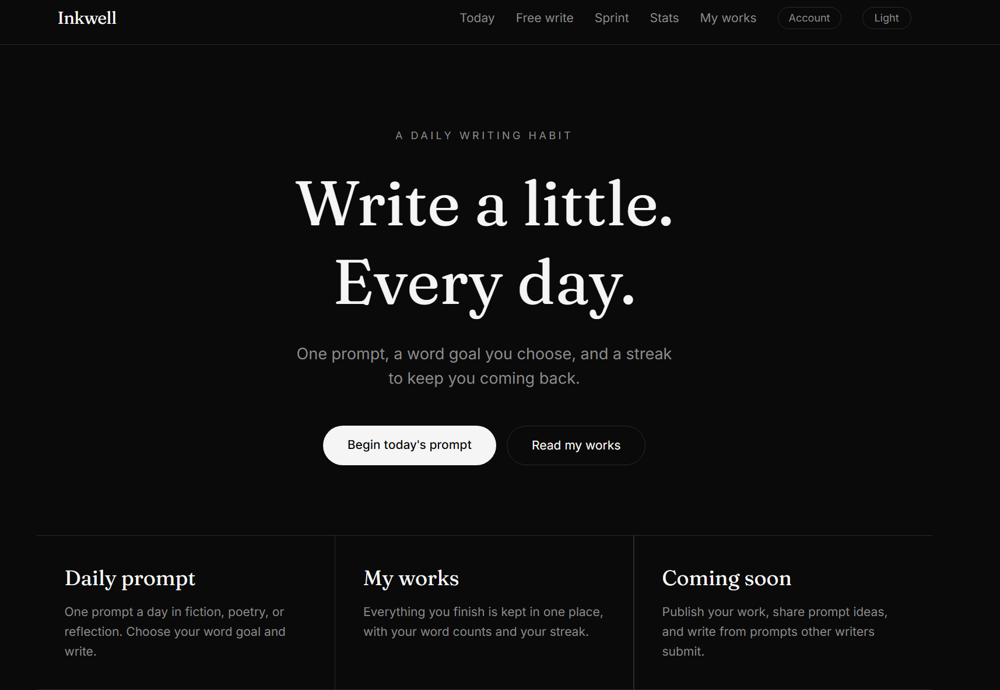    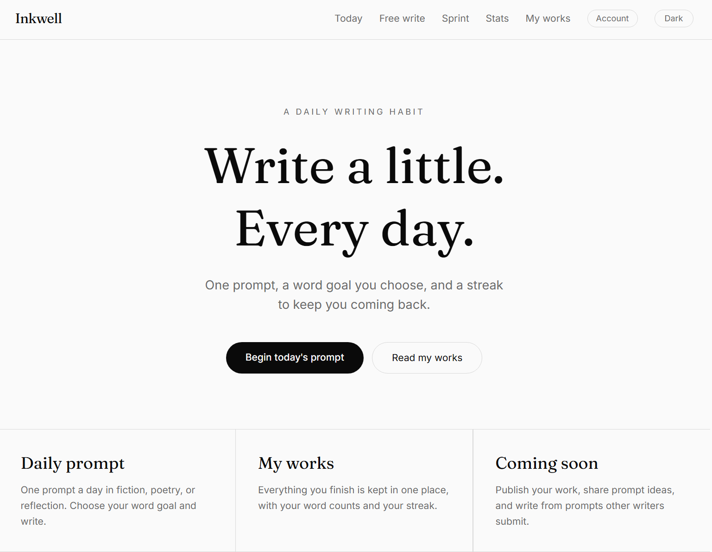

-Daily Writing-
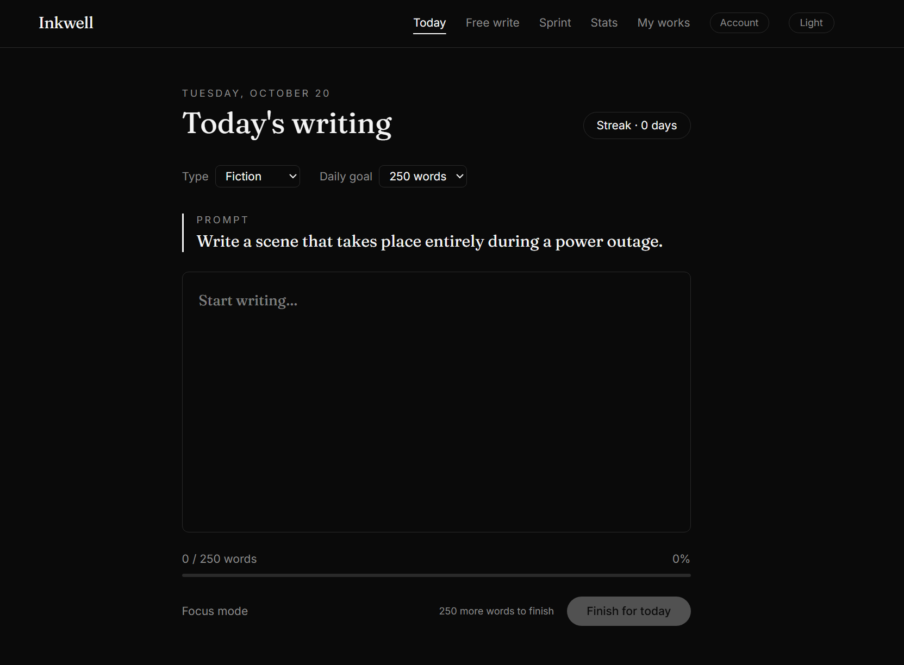      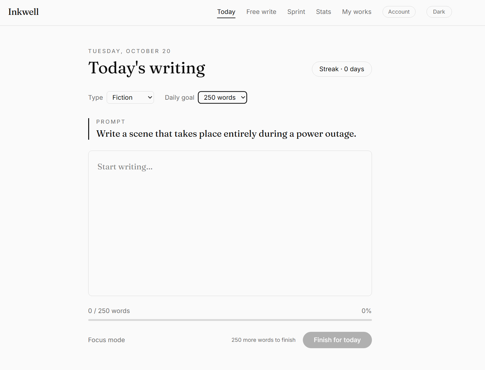

-Free Writing-
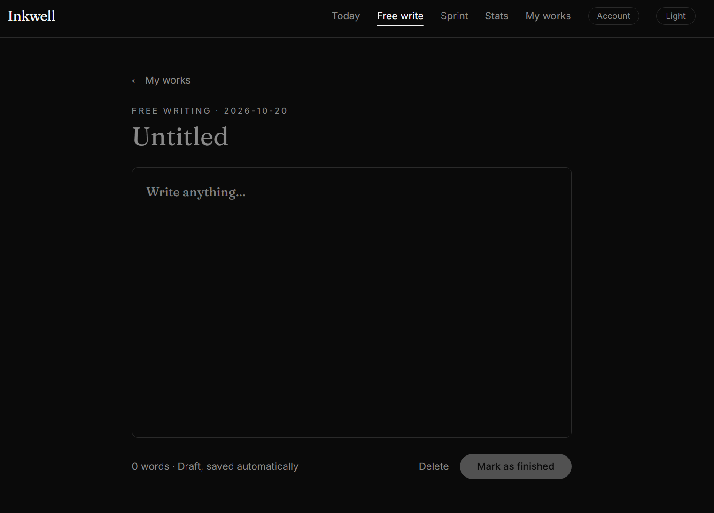

-Spring Writing-
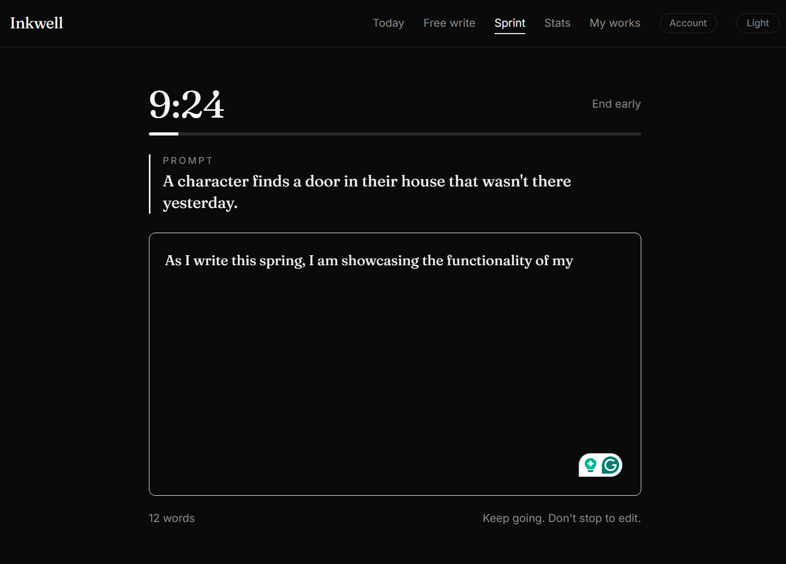     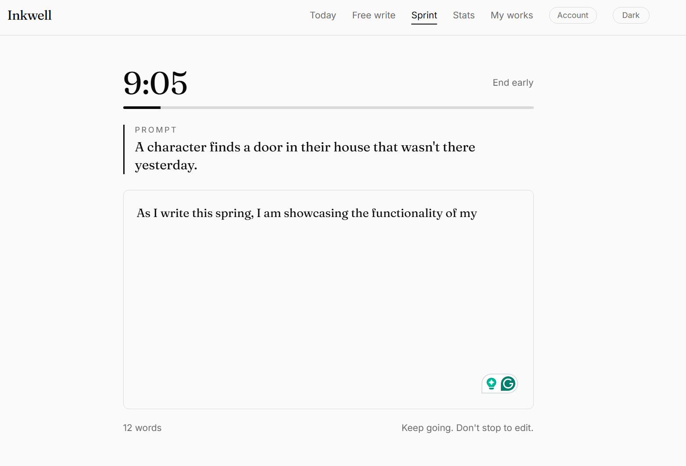        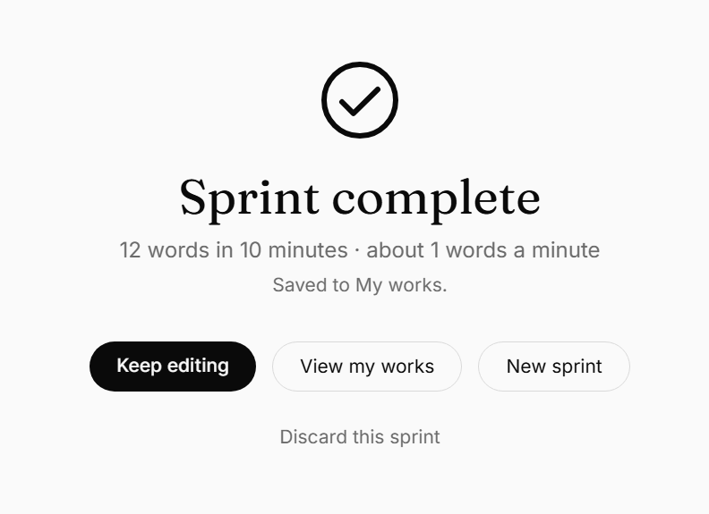

-Status Page-
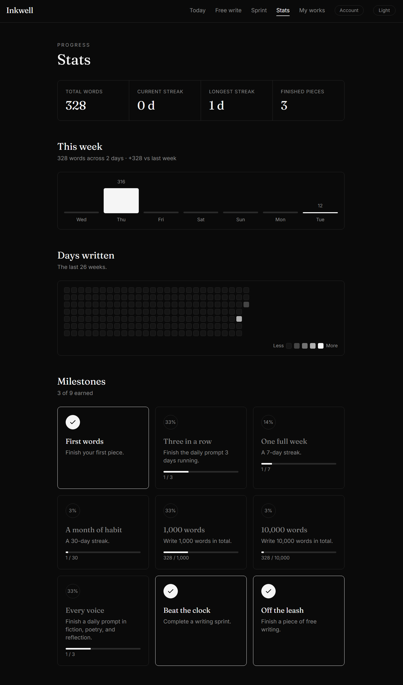     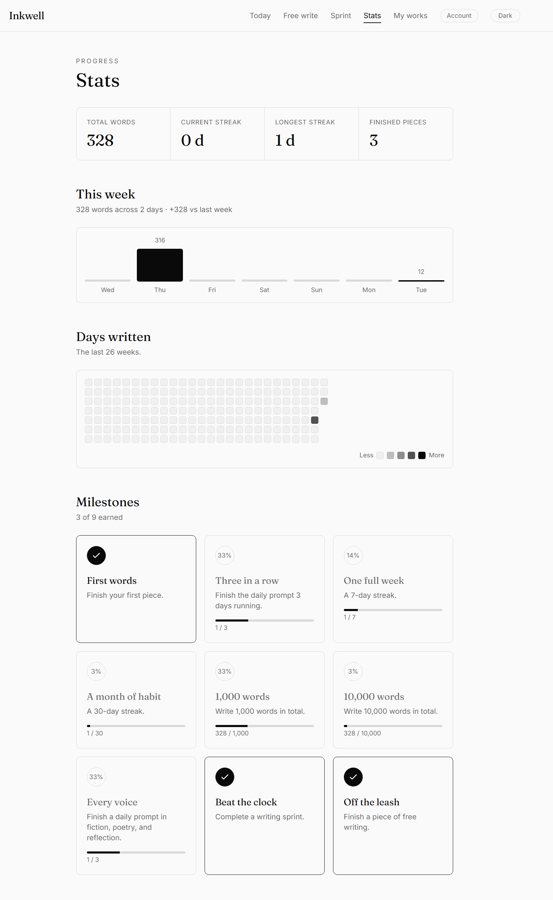

-History Page-
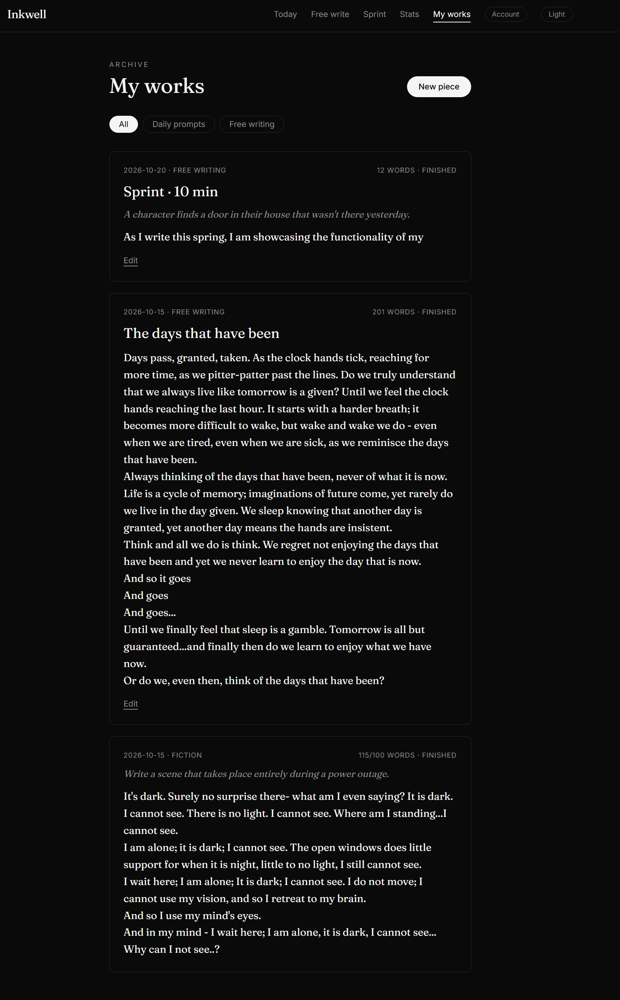      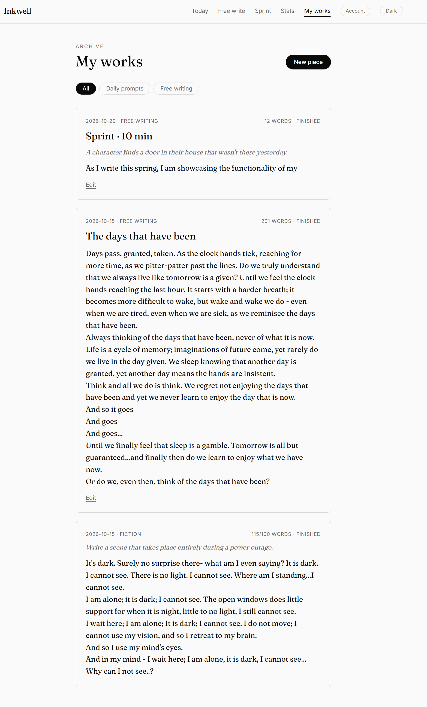
## Features

- **Daily prompts** in three categories: fiction, poetry and reflection. Prompts are generated from a seeded engine, so everyone gets the same prompt on the same day.
- **Another prompt and challenge mode.** Don't like today's prompt? Shuffle it before you start. Switch on challenge mode for an extra constraint such as "use no adjectives".
- **Word goals** of 100, 250 or 500 words, with a live counter and progress bar.
- **Finish for today.** A deliberate submit action that locks the entry and counts it toward your streak. You can unlock it later to edit.
- **Focus mode.** A full-screen view with only the prompt and your text.
- **Free writing.** Personal pieces with a title and no goal.
- **Sprints.** Write without stopping for 5, 10 or 15 minutes, with a soft chime at the end.
- **Stats.** Total words, current and longest streak, a weekly summary and a calendar of days written.
- **Milestones.** Black-and-white badges for streaks, word counts and more.
- **Light and dark mode.** Follows your system setting and remembers your choice.
- **Accounts and sync.** Email and password sign-in through Supabase. The app works without an account.

## Tech stack

- [Next.js 16](https://nextjs.org/) (App Router) and React
- TypeScript
- Tailwind CSS v4
- [Supabase](https://supabase.com/) for authentication and the Postgres database, protected by Row Level Security
- Fraunces and Inter fonts through `next/font`

## Getting started

### Requirements

- Node.js 20 or newer
- Git
- A free Supabase project (optional, only needed for accounts and sync)

### 1. Install

```bash
git clone https://github.com/Anoire-A/Inkwell.git
cd Inkwell
npm install
```

### 2. Environment variables

Create a file named `.env.local` in the project root:

```
NEXT_PUBLIC_SUPABASE_URL=https://YOUR-PROJECT-ID.supabase.co
NEXT_PUBLIC_SUPABASE_PUBLISHABLE_KEY=your-publishable-key
```

Use only the publishable (anon) key. Never put the secret or service_role key in this project. Without these variables the app still runs in local-only mode.

### 3. Database

In the Supabase dashboard, open SQL Editor and run:

```sql
create table public.entries (
  user_id uuid not null references auth.users (id) on delete cascade,
  id text not null,
  kind text not null check (kind in ('daily', 'free')),
  entry_date date not null,
  category text check (category in ('fiction', 'poetry', 'reflection')),
  title text not null default '',
  prompt text not null default '',
  body text not null default '',
  words integer not null default 0,
  goal integer not null default 0,
  completed boolean not null default false,
  submitted boolean not null default false,
  sprint_minutes integer,
  updated_at timestamptz not null default now(),
  primary key (user_id, id)
);

alter table public.entries enable row level security;

create policy "Users read own entries" on public.entries
  for select to authenticated
  using ((select auth.uid()) = user_id);

create policy "Users insert own entries" on public.entries
  for insert to authenticated
  with check ((select auth.uid()) = user_id);

create policy "Users update own entries" on public.entries
  for update to authenticated
  using ((select auth.uid()) = user_id)
  with check ((select auth.uid()) = user_id);

create policy "Users delete own entries" on public.entries
  for delete to authenticated
  using ((select auth.uid()) = user_id);
```

While developing, you can turn off "Confirm email" under Authentication, Providers, Email so sign-up works instantly. Turn it back on before real users arrive.

### 4. Run

```bash
npm run dev
```

Open [http://localhost:3000](http://localhost:3000). Restart the dev server after changing `.env.local` or `next.config.ts`.

### Testing on a phone

Next.js blocks dev scripts from other addresses. Add your computer's local IP to `next.config.ts`:

```ts
const nextConfig: NextConfig = {
  allowedDevOrigins: ["192.168.1.50"], // your IPv4 address
};
```

Then open `http://YOUR-IP:3000` on a device on the same Wi-Fi. Browser storage is separate per address, so sign in on the phone to pull your writing from the cloud.

## Scripts

| Command | What it does |
| --- | --- |
| `npm run dev` | Start the development server |
| `npm run build` | Create a production build |
| `npm run start` | Run the production build |
| `npm run lint` | Run ESLint |

## Project structure

```
app/            Pages and routes (write, compose, sprint, stats, history, account)
components/     Header, theme toggle, sync provider
data/           Prompt pool, generator parts and challenge constraints
lib/            Storage, sync, streaks, stats, milestones, prompt engine, Supabase client
```

## How it works

**Local-first.** Every keystroke saves to `localStorage` immediately, so typing never waits on the network. When you are signed in, changes are uploaded to Supabase about 1.5 seconds after you stop typing, and the app merges in anything newer from the cloud when it loads. If the same piece exists in both places, the most recent edit wins.

**Prompt engine.** The daily prompt is chosen by a seeded random generator keyed on the date and category, so it is the same for everyone and needs no server. About a third of prompts are hand-written. The rest are assembled from lists of characters, situations, settings, subjects and angles, which gives hundreds of distinct combinations per category.

**Security.** Row Level Security policies guarantee each user can only read and write their own rows.

## Roadmap

- [x] Daily prompts, word goals, streaks
- [x] Free writing and sprints
- [x] Stats and milestones
- [x] Accounts and cloud sync
- [x] Dynamic prompt engine
- [ ] Community prompt ideas, voting and a "prompt of the day" from top-voted ideas
- [ ] Publishing finished work, with private by default
- [ ] Mobile navigation and installable app
- [ ] Export to Markdown and PDF
- [ ] Deployment

## Known limitations

- Other devices pick up changes when the page loads or when you press Sync now. It is not live.
- A deletion made while offline can come back on the next sync.
- Badges are calculated from your entries, so deleting a piece can remove a badge.